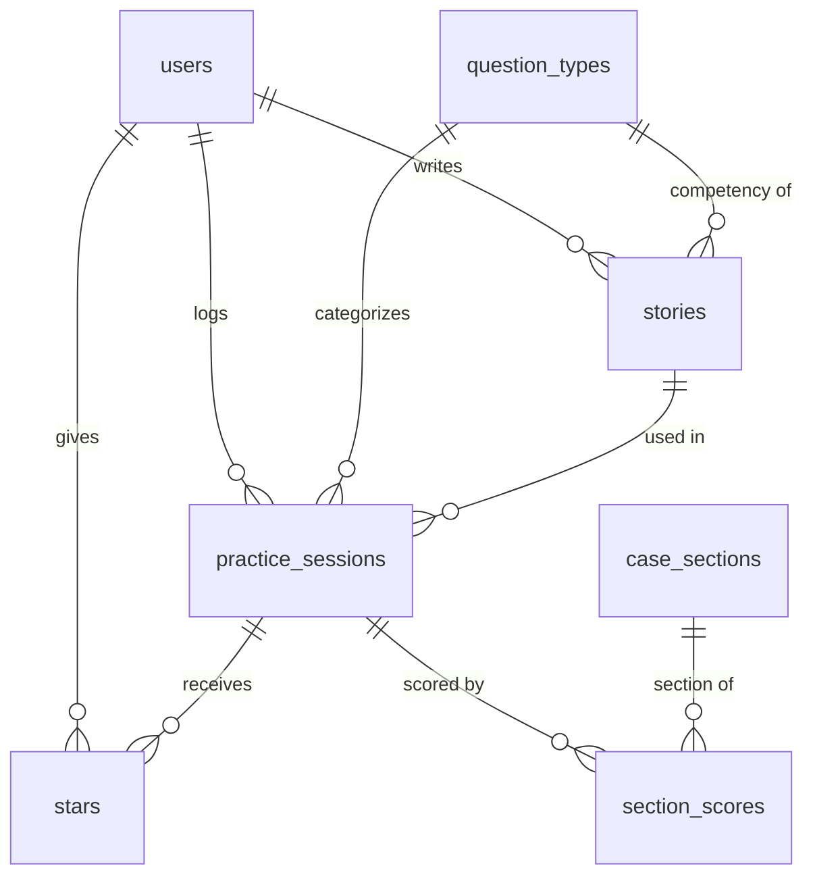

# PLAN.md — InterviewPrep: Case & Behavioral Interview Tracker

## 1. Pitch

I'm building **InterviewPrep**, a tracker for consulting case practice and behavioral interview stories, because I'm recruiting for consulting this fall and this lives in a difficult to read spreadsheet. I want to score every case section by section, see which case types and sections are my weakest, keep my behavioral stories in one place, and walk into my next case knowing exactly what to work on.

**How often:** TODO(Daisuke): 2-3 times a week*

## 2. Features (in build order)

1. **Sign up and login** *(spine).* As a new visitor, I want to create an account with my email and password, then log in and log out, so that my prep data is private to me.
2. **Data model** *(spine).* As a user, I want each practice session saved with its question type (e.g. Profitability, Market Entry for cases; Leadership, Teamwork for behavioral), so that my practice is organized by what I'm being tested on.
3. **Create / read / update / delete sessions** *(spine).* As a user, I want to log a practice session (date, question type, prompt, format, overall 1–5 score, minutes, overall notes), view my list, open a session's detail page, edit it, and delete it after an "are you sure?" confirmation, so that my log stays accurate.
4. **Case scorecard** *(my feature 1).* As a user, I want to score each section of a case, Introduction, Framework, Exhibits, Math, Brainstorm, Recommendation, and Driving the case forward, from 1 to 5 (or mark it N/A if the case didn't include it), and write what went well and what to improve for each section, so that I know exactly which parts of a case I'm strong and weak at. The detail page shows the full scorecard, and editing a session updates its existing section scores instead of creating duplicates.
5. **Validation** *(spine).* As a user, I want a friendly message if I leave date, question type, prompt, or overall score blank, or enter any score outside 1–5, so that I never save a half-finished or invalid entry.
6. **Stars** *(spine).* As a user, I want to star sessions I want to redo and see them in a "Starred" view, so that I have a redo list of cases that went badly.
7. **Find things** *(spine).* As a user, I want to search my sessions by keyword (prompt and notes), filter by kind (case/behavioral) and question type, and sort by newest, oldest, highest score, or lowest score, so that I can quickly find, say, every profitability case I scored under 3.
8. **Dashboard** *(spine).* As a user, I want to see:
   - my total number of cases, and the count for each case type;
   - my average overall score;
   - my weakest case type, meaning the lowest average overall score among types with at least 2 sessions;
   - a bar chart of my average score for each of the 7 case sections;
   - a section heatmap: a grid with the 7 case sections as rows and my 10 most recent cases as columns, where each cell shows that section's score colored by the score scale (blank for N/A),

   so that I know where I stand, and a weak section jumps out at a glance as a red row.
9. **Next-case focus** *(my feature 2).* As a user, I want a "Focus for your next case" card on the dashboard. It shows the 2 sections with the lowest average score across my 5 most recent case sessions, each with my most recent "to improve" note for that section, so that I start every case with two concrete things to work on.
10. **STAR story bank** *(my feature 3).* As a user, I want to add, edit, and delete my behavioral stories (title, context, Situation, Task, Action, Result, and main competency), and link a behavioral practice session to the story I used, so that my existing and new stories live in one place. Each story's page shows how many times I've practiced it and its average score.

## 3. Database

| Table | Column | Type | Notes |
|---|---|---|---|
| **users** | id | number | Primary key |
| | email | text | Unique, required |
| | password_hash | text | Hashed, never stored in plain text |
| | created_at | date | |
| **question_types** | id | number | Primary key |
| | name | text | e.g. "Profitability", "Market Sizing", "Leadership" |
| | kind | text | "case" or "behavioral" |
| **practice_sessions** | id | number | Primary key |
| | user_id | number | → users.id |
| | question_type_id | number | → question_types.id |
| | story_id | number | → stories.id, optional (behavioral sessions only) |
| | session_date | date | Required |
| | prompt | text | Required, e.g. "Coffee chain profits down 15%" |
| | format | text | "solo", "partner", or "mock" |
| | overall_score | number | Required, 1–5, my overall judgment of the session |
| | duration_minutes | number | Optional |
| | went_well | text | Optional, overall notes |
| | to_improve | text | Optional, overall notes |
| | created_at | date | |
| **case_sections** | id | number | Primary key |
| | name | text | Introduction, Framework, Exhibits, Math, Brainstorm, Recommendation, Driving the case forward |
| | display_order | number | Order the sections appear on the form |
| **section_scores** | id | number | Primary key |
| | session_id | number | → practice_sessions.id |
| | section_id | number | → case_sections.id |
| | score | number | Required, 1–5 |
| | went_well | text | Optional |
| | to_improve | text | Optional |
| **stars** | user_id | number | → users.id; part of composite primary key |
| | session_id | number | → practice_sessions.id; part of composite primary key |
| | created_at | date | |
| **stories** | id | number | Primary key |
| | user_id | number | → users.id |
| | competency_id | number | → question_types.id (behavioral kind) |
| | title | text | Required |
| | context | text | e.g. "FP&A, budget reforecast" |
| | situation, task, action, result | text | STAR fields |
| | created_at | date | |

**Relationships**

- A user has many practice sessions and many stories (one-to-many).
- A question type has many practice sessions (one-to-many).
- A case session has many section scores, at most one per section (one-to-many). A section marked N/A simply has no row.
- A case section has many section scores across all sessions (one-to-many).
- A story can be used in many behavioral sessions (one-to-many).
- Users and sessions connect through **stars** (many-to-many).
- `question_types` and `case_sections` are shared, pre-loaded reference data that is the same for everyone. Every other table belongs to one user, and the app only ever shows a user their own rows.
- The overall score is entered separately rather than averaged from the sections, because interviewers judge holistically. Strong math doesn't save a missing recommendation.

## 4. Tests

1. **Data isolation.** Given User A has logged a session "Coffee chain profitability" and User B is a separate account, when User B loads their sessions list and also requests User A's session directly by its ID, then User B's list is empty and the direct request returns "not found."
2. **Dashboard average.** Given a user has three sessions with overall scores of 3, 4, and 5, when they open the dashboard, then the average score shows 4.0.

## 5. Technologies

- **Coding agent: Replit Agent.** It builds, runs, and hosts in one place, which matters with a four-day timeline.
- **Database: Replit's built-in PostgreSQL.** It's a real relational database that supports the foreign keys and junction tables above, with no separate account to set up.
- **Sign up and login: email and password, built in the app and hashed with bcrypt, with session cookies.** Every account is a row in my own users table, which makes data isolation easy to enforce and test.
- **Hosting: Replit Deployments.** The live URL comes from the same workspace I build in, and I redeploy after each merged PR.
- **Stack: React front end, Node/Express back end.** This is Replit Agent's default full-stack setup, so I'm working with the agent rather than against it.
- **Libraries:** Recharts for the dashboard chart (simple React charting), and Vitest with Supertest for the two tests (can call the app's API as two different logged-in users).
- **Version control: GitHub,** with a rule that requires a pull request to merge into main, so nothing can be committed to main directly.

## 6. Design

- **Direction: "Consulting deck."** The app is clean and professional, with plenty of white space. The one borrowing from fitness apps: dashboard numbers are big and bold.
- **Colors:** Navy (#1F2A44) for the header and text, a white background, light gray (#F2F4F7) stat cards, and one green accent (#2E9E6B). Red is used only for low scores and delete buttons.
- **Score color scale, used everywhere:** 1–2 red (#C0392B), 3 amber (#D68910), 4–5 green (#2E9E6B). The number is always shown next to the color, so meaning never depends on color alone.
- **Typography:** A clean sans-serif (Inter). Stat numbers are large and bold.
- **Scorecard:** One compact row per section, like an interviewer's feedback form. Each row has tap buttons for 1–5 plus N/A (no dropdowns). The "went well" and "to improve" notes for a section expand when tapped, so the form stays short on a phone.
- **Phone and laptop:** Designed for the phone first, since I'll log right after a case, but it also works well on a laptop.
  - **On a phone (around 375px wide):** Single column, with stat cards in a 2×2 grid. The heatmap scrolls sideways inside its own box, never the whole page. Buttons and tap targets are at least 44px tall.
  - **On a laptop:** Stat cards sit in one row, and the bar chart and heatmap sit side by side.
- **Inspiration:**
  - Notion, for list and detail pages
  - Consulting slides, for big takeaway numbers
  - Strava, for bold stats
  - GitHub's contribution graph, for the heatmap

## 7. Risks and cuts

- **Least sure I can build:** The case scorecard (feature 4). It's one form that saves to two tables, with N/A handling, and editing must update existing section scores rather than duplicate them.
- **Cut first:** If time runs short, I'll simplify Next-case focus (feature 9) to a single "weakest section" stat. Next, I'll drop the heatmap, since the bar chart already meets the dashboard requirement. If I'm still short after that, I'll drop the link between behavioral sessions and stories, so the story bank stands alone.
- **Backlog (only if time allows):** A practice streak counter; tagging stories with multiple competencies; and a competency coverage view showing which competencies have no story yet.
