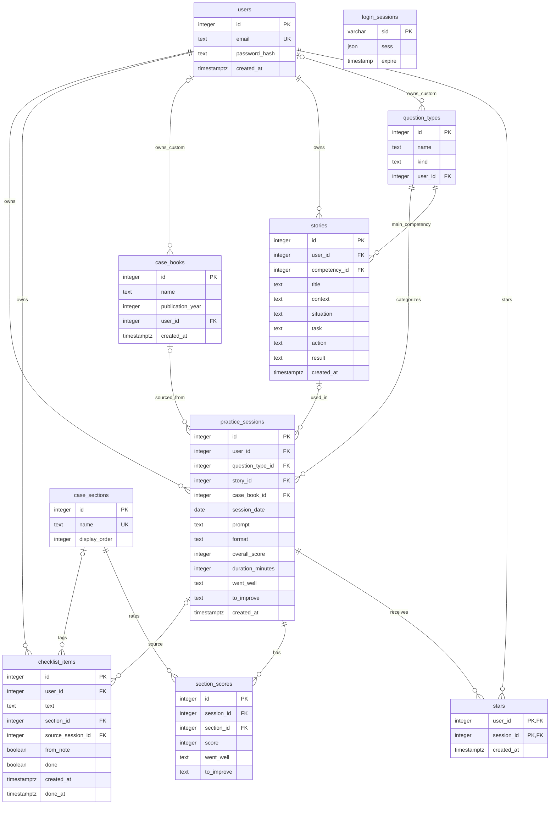

# InterviewPrep database schema — Features 1–13

The application's SQL source of truth is
`artifacts/interviewprep/server/schema.sql`. There are nine product tables
(`users`, `question_types`, `practice_sessions`, `case_sections`, and
`section_scores`, `stars`, `stories`, `case_books`, and `checklist_items`) plus the existing technical `login_sessions` table used for
authentication. Behavioral practice sessions may optionally link to an owned story.

## users

| Column | PostgreSQL type | Rules |
| --- | --- | --- |
| id | integer (`SERIAL`) | Primary key, automatically assigned |
| email | text | Required, unique, checked to be lowercase |
| password_hash | text | Required bcrypt password hash, never plaintext |
| created_at | timestamp with time zone | Required, defaults to `now()` |

## question_types

Shared and private categories use the same table: shared types have no owner;
custom types belong to one user. Custom categories are behavioral only.

| Column | PostgreSQL type | Rules |
| --- | --- | --- |
| id | integer (`SERIAL`) | Primary key, automatically assigned |
| name | text | Required; normalized uniqueness for shared names and within each owner |
| kind | text | Required; database check allows only `case` or `behavioral` |
| user_id | integer, nullable | References users.id, ON DELETE CASCADE; NULL for shared types |

Names are compared ignoring capitalization, leading/trailing whitespace, and
repeated whitespace. Partial unique indexes enforce shared and per-owner
uniqueness; a database trigger also rejects new private/shared name collisions and
non-behavioral custom types. Equal names for two different private owners are
allowed. Custom names must be nonblank and at most 40 characters.
New shared seeds may coexist with pre-existing private categories without
changing those categories' IDs, kinds, or historical session links.

Initial reference rows:

- **Case:** Market Sizing, Profitability, Market Entry, M&A, Growth Strategy,
  Pricing, Operations, Private Equity, Wildcard.
- **Behavioral:** Leadership, Teamwork, Conflict, Failure / Setback, Impact,
  Why Consulting, Tell me about yourself, Why this firm, Influencing without
  authority, Entrepreneurial drive, Courageous change, Navigating ambiguity,
  Giving and receiving feedback, Problem solving, Inclusive leadership,
  Working under pressure, Other.

## case_books

Shared books have no owner; custom books belong to one user. A case book has many
case sessions, while a case session has one book or none.

| Column | PostgreSQL type | Rules |
| --- | --- | --- |
| id | integer (`SERIAL`) | Primary key |
| name | text | Required, nonblank, at most 60 characters |
| publication_year | integer, nullable | Optional four-digit publication year (1000–9999); NULL means unknown |
| user_id | integer, nullable | References users.id, ON DELETE CASCADE; NULL means shared |
| created_at | timestamp with time zone | Required, defaults to now() |

Partial unique indexes and a scope-check trigger enforce case-insensitive,
whitespace-normalized uniqueness for the **same name and publication year**
within each owner's editions and prevent new private duplicates of shared
editions. Shared seeds may coexist with pre-existing private editions. Different years are separate
books with separate IDs, session filters, and dashboard aggregates. Unknown-year
books are distinct from dated editions; two unknown-year books with the same
name still conflict within the same visibility scope. Different private owners
may use the same edition. Server identity—not submitted
`user_id`—determines ownership. Lists, saves, and filters enforce visibility.

Shared seeds: Case in Point, Victor Cheng (Case Interview Secrets), Haas Casebook,
Wharton Casebook, Kellogg Casebook, Columbia Casebook, Darden Casebook, Tuck
Casebook, Ross Casebook, Fuqua Casebook, MIT Sloan Casebook, Stern Casebook,
Firm website practice cases, Booth Casebook. Shared seeds insert only missing
rows at startup. A newly shared book may coexist with a legacy private edition;
existing private IDs and session links are never changed. New private duplicates
of an already-shared edition are still rejected.

`GET /api/case-books` returns `{ books, most_recent_case_book_id }`: shared books
alphabetically, then the user's private books alphabetically. The most recent
case is ordered by session date, creation timestamp, then ID descending. Its book
ID (including NULL for a live case) defaults the new-session form's book name
AND year; editing pre-fills the saved name and year, and refetching never
overwrites a user's draft choice.
`POST /api/case-books` accepts `{ name, publication_year? }` and creates a private
book. The year is optional; omitted/null leaves it unknown. Existing books and
links keep their IDs and an unknown year; shared seed years are never guessed.
The session form lists each normalized name once, combines shared and owned
editions by name, and has a separate optional typed edition year. Inline add
asks for a name only. When saving a session, `case_book_id` must be shared or
owned by the logged-in user. The server takes that book's name and the submitted
`case_book_publication_year` (blank, omitted, or NULL means unknown) and resolves:

1. A shared edition with that normalized name and year.
2. Otherwise, that user's private edition with that name and year.
3. Otherwise, a new private edition for that user.

Resolution and session saving share a transaction. A transaction-scoped advisory
lock using the same normalized name/year key as the scope trigger serializes
lookup plus insert; the unique edition indexes also remain in place. Two quick
saves reuse one private edition. Other owners' books are never eligible, even
when the submitted ID or name/year matches. No editions table was added.

New typed years must be whole numbers from 1990 through next calendar year
(calculated at validation time). The broader existing database range is retained
to avoid altering historical rows. Filters, session cards/details, dashboard book
rows, and Excel still distinguish and label editions as `Name (2025)`.
Session responses expose `case_book_publication_year`; dashboard book rows expose
`publication_year`.

## practice_sessions

Each practice session belongs to exactly one user. Feature 3 uses this existing
table for the authenticated practice log, creation, detail, editing, and deletion.
Feature 10 adds an optional story link without replacing existing session data.

Interview style is case-only: empty/omitted values are stored as NULL, and saving
a session as behavioral clears the style. `GET /api/sessions?style=` accepts
`interviewer_led`, `candidate_led`, `not_sure`, or `not_set` (case sessions with
NULL style), always within the logged-in user's data. Dashboard `by_case_style`
uses owned case sessions, rounds overall averages to one decimal, and includes
a weakest section only when it has been scored at least twice within that style.
Apply the updated idempotent `schema.sql` before running this version against an
existing database; seeding does not perform schema migrations.

| Column | PostgreSQL type | Rules |
| --- | --- | --- |
| id | integer (`SERIAL`) | Primary key, automatically assigned |
| user_id | integer | Required foreign key to `users.id`; `ON DELETE CASCADE` |
| question_type_id | integer | Required foreign key to `question_types.id` |
| story_id | integer, nullable | Foreign key to `stories.id`, `ON DELETE SET NULL`; only an owned story on a behavioral session |
| case_book_id | integer, nullable | Foreign key to case_books.id, ON DELETE SET NULL; shared or owned book on a case session only |
| case_style | text, nullable | Optional `interviewer_led`, `candidate_led`, or `not_sure`; database CHECK rejects other non-NULL values |
| session_date | date | Required calendar date, no time of day |
| prompt | text | Required |
| format | text | Required, defaults to `solo`; database check allows `solo`, `partner`, or `mock` |
| overall_score | integer | Required; database check allows only 1 through 5 |
| duration_minutes | integer | Optional |
| went_well | text | Optional overall notes |
| to_improve | text | Optional overall notes |
| created_at | timestamp with time zone | Required, defaults to `now()` |

The database enforces required values, valid kinds/formats, score range, integer
types, and foreign keys, regardless of which client submits data. Session owner,
type, story, and book references are indexed. Deleting a user deletes their practice sessions;
deleting a question type that is referenced by a session is rejected.
Deleting a case book clears its links, preserving sessions, scores, and stars.
Switching a session to behavioral clears the book. A NULL book means
"No book / live case". Omitted/null `case_book_id` on an update clears the link.
List/detail responses include `case_book_name`. `GET /api/sessions?book=<id>`
filters by a visible book; `book=none` returns only case sessions without books.
The dashboard's `by_case_book` groups owned case sessions by book (including
NULL), with count, one-decimal average score, and last practiced date, ordered
by count descending. It is empty when there are no case sessions.

## login_sessions (existing authentication infrastructure)

This is the separately approved session-store table from Feature 1, not an
interview-practice table.

| Column | PostgreSQL type | Rules |
| --- | --- | --- |
| sid | character varying | Primary key, required; login-session identifier |
| sess | json | Required; server-side session data |
| expire | timestamp without time zone, precision 6 | Required; expiry time, indexed |

The authenticated user's numeric ID is stored inside `sess` by express-session.
This is not a relational foreign key to `users`; deleting a user does not
automatically delete these cookie sessions. Authentication middleware checks
that the referenced user still exists before allowing protected API access.

## checklist_items — improvement checklist

| Column | PostgreSQL type | Rules |
| --- | --- | --- |
| id | integer (`SERIAL`) | Primary key |
| user_id | integer | Required FK to users.id, ON DELETE CASCADE |
| text | text | Required, nonblank, up to 200 characters |
| section_id | integer, nullable | Optional FK to case_sections.id |
| source_session_id | integer, nullable | Optional FK to practice_sessions.id, ON DELETE SET NULL |
| from_note | boolean | Required, default false; retains provenance after source deletion |
| done | boolean | Required, default false |
| created_at | timestamp with time zone | Required, defaults to now() |
| done_at | timestamp with time zone, nullable | Set when done, cleared when undone |

The database enforces a unique `(user_id, source_session_id,
coalesce(section_id, 0))` for non-null source sessions. Thus the overall note
(no section) and each section note have separate identities. Concurrent requests
for the same note return the existing item, preserving its edited text and
completion state, rather than inserting a duplicate. Manual items have no source
and are not deduplicated by text.

All `/api/checklist` routes require login and writes require the existing CSRF
token. Ownership comes from the server session, never request input. Foreign
items and source sessions return `404 {"message":"Item not found"}`.
`GET` returns open items newest first, the ten most recently completed items,
the full completed count, and note membership including older completed items.
`POST` accepts text and an optional section, or a source session plus optional
section; source text is copied on the server. Blank or over-200-character notes
return the same friendly text validation errors rather than silently truncating.
`PATCH /:id` edits text and/or toggles done with its timestamp. `DELETE /:id`
deletes one item; `DELETE /completed` deletes only this user's completed items.
Deleting a source session keeps copied text and completion state; deleting the
owning user removes their checklist. Shared case sections remain unchanged.

## Relationships in plain English

- A user has many practice sessions. Each practice session belongs to one user.
- A user has many checklist items; each item belongs to exactly one user.
- A checklist item can optionally point to a case section and to the session it came from.
- Deleting a source session clears its checklist links, but keeps the items and their copied text.
- A case book has many case sessions; shared books have no owner, custom books belong to one user.
- A session may use one case book or none; deleting a book never deletes its sessions.
- A question type has many practice sessions. Each practice session has one
  question type.
- Users see shared question types and only their own private behavioral categories.
- A user has many stories. Each story belongs to exactly one user.
- Each story has one main competency: a behavioral question type.
- A story can be used in many behavioral sessions. A session may use one story or none.
- Deleting a story clears the link on its sessions; it never deletes those sessions or their scores.
- Users and practice sessions connect many-to-many through `stars`.
  The table supports many user/session pairs; the current API only permits
  starring a session the logged-in user owns.
- A login session may refer to a user through its JSON payload; that is an
  application-level relationship, not a database foreign key.



## Migration and automatic seeding

1. **Development:** The existing development-only `scripts/post-merge.sh`
   installs dependencies and applies `server/schema.sql`. The SQL adds missing
   tables/indexes without dropping existing tables or account data.
2. **Production schema:** When the user chooses to publish, Replit's managed
   Publish process applies the development-to-production schema comparison.
    Review that comparison to ensure all ten tables, `question_types.user_id`,
   its cascading foreign key, the normalized-name indexes and scope-check
   function/trigger, case-book normalized-name indexes and scope-check trigger,
   and the `story_id` and `case_book_id` foreign keys exist before serving the
   updated app. The old global `question_types_name_key` constraint is replaced
   by scoped uniqueness; no existing rows or IDs are changed. No custom production
   migration or startup DDL is used.
3. **Startup seeding, both environments:** Before opening its listening port,
   `server/index.mjs` calls `seedQuestionTypes()`, `seedCaseSections()`, and
   `seedCaseBooks()`. Parameterized inserts
   adds missing shared rows with `ON CONFLICT DO NOTHING`, checking shared rows
   only. Existing rows and IDs
   are preserved. Repeated or simultaneous startups do not duplicate names.
   This runs against the app's configured database in development and in
   production; production does not depend on copying development table data.
4. Seeding requires the schema to exist first. If provisioning or the database
   is unavailable, startup fails rather than presenting a fake reference list.

No app publishing or production database modification was performed for this
feature. Production-settings tests use only an isolated development schema.

## API and welcome page

`GET /api/question-types` requires the Feature 1 login session and returns:

```json
{
  "case": [{"id": 1, "name": "Growth Strategy", "kind": "case", "user_id": null}],
  "behavioral": [{"id": 8, "name": "Conflict", "kind": "behavioral", "user_id": null}]
}
```

The example is abbreviated and IDs are illustrative, not fixed. All question
types are scoped to the current user. Behavioral ordering is shared alphabetically,
then custom alphabetically, with Other last. `POST /api/question-types` accepts
`{ "name": "Coaching" }`; kind is always behavioral and ownership always comes from
the authenticated session. Session/story saves and filters reject another user's
custom category. Unauthenticated requests
return HTTP 401. The welcome page consumes this API to display the Case and
Behavioral chips under “Your practice areas,” with loading, retry, and empty
states rather than hardcoded reference data.

## Checks and manual preview

- Run `pnpm test` for auth regressions, reference seeding, database constraints,
  user-session cascade, protected API access, and production-settings checks.
- Run `pnpm typecheck` for workspace TypeScript checks.
- In Preview, log in and confirm the welcome page lists all seven case types
  and all seventeen shared behavioral types plus your custom categories; refresh
  and confirm they remain.
- At phone width, chips wrap within the cards without page-wide horizontal
  scrolling. At laptop width the groups appear side by side.
- Log out and request `/api/question-types`; expect HTTP 401.
- Restart the product workflow and confirm no duplicate reference rows appear.

## Practice-session API (Feature 3)

All endpoints require the current login session. POST, PUT, and DELETE also
require its `X-CSRF-Token`. Ownership always comes from the authenticated user,
never a submitted `user_id`. Missing, malformed, and foreign IDs return the
same HTTP 404 response, including for updates and deletion.

| Method | Endpoint | Result |
| --- | --- | --- |
| GET | `/api/sessions` | Matching owned sessions plus the user's total count; newest date first by default |
| POST | `/api/sessions` | Create and return a session with HTTP 201 |
| GET | `/api/sessions/:id` | Return one owned session |
| PUT | `/api/sessions/:id` | Replace editable fields on an owned session |
| DELETE | `/api/sessions/:id` | Delete an owned session with HTTP 204 |

Session responses contain `id`, all editable fields, `question_type_name`,
`kind`, and `created_at`. They do not expose `user_id`. `session_date` is a
`YYYY-MM-DD` calendar-date string, without time-zone conversion.

POST and PUT require `session_date` (a real calendar date, not in the future), `question_type_id`
(an existing shared type), nonblank `prompt`, `format` (`solo`, `partner`, or
`mock`), and integer `overall_score` from 1 to 5. Optional `duration_minutes`
is null or a whole number from 1 to 600. Optional `went_well` and
`to_improve` are overall notes, not section feedback. Text is trimmed and
limited to 4,000 characters per field. Omitted/blank optional notes and omitted
or null minutes become SQL NULL; PUT can explicitly clear existing values.
Numeric JSON fields must be numbers, not numeric strings.

Invalid fields return HTTP 400:

```json
{
  "errors": {"overall_score": "Please give this session an overall score from 1 to 5."}
}
```

The UI performs matching inline checks and displays server field errors.
Both POST and PUT use the shared server validator before writing any data.
Invalid requests leave the parent session and all section scores unchanged.
New and edit forms disable native validation bubbles, retain drafts, show red
field messages and a summary, and scroll/focus the first invalid field on submit.
Each field error clears once that field is corrected, without moving focus.
Nonempty section scores are rejected for behavioral sessions; case section IDs
must exist, cannot repeat, and must have whole-number scores from 1 to 5.
The OpenAPI contract and generated React Query hooks live in `lib/api-spec`
and `lib/api-client-react`. The Express router validates inputs before SQL and
uses parameterized, ownership-scoped queries for every read and mutation.

Protected frontend routes:

- `/sessions` — saved practice log, with loading, retry, and empty states.
- `/sessions/new` — create a practice session.
- `/sessions/:id` — session detail and confirmation-before-delete.
- `/sessions/:id/edit` — edit current values, including clearing optional fields.

`pnpm test` includes real-database session CRUD, invalid input, CSRF, date
round-trip, deletion persistence, and two-user isolation tests. Browser checks
should cover create → reload → edit → reload → cancel deletion → confirm
deletion, and check phone/laptop layouts. No stars, dashboard, or
story features are included.

The root `npm test` script also runs Vitest with Supertest against the exported
Express app (no listening server required). `tests/data-isolation.test.ts`
signs up two uniquely named accounts using separate cookie agents, creates
“Coffee chain profitability” as User A, checks that User B's list is empty and
direct access returns 404 `Session not found`, and confirms User B cannot update
or delete A's record. It also checks that a forged `user_id` cannot change
ownership. Cleanup removes the test login sessions and accounts, relying on
the foreign-key cascade to remove only their practice sessions.

The session form filters its question-type dropdown with a Case/Behavioral
toggle, infers the correct toggle when editing, and clears the selection when
switching kinds. For Feature 3, save failures show only
“Couldn't save. Please check your entries.” Server-side input checks remain in
place for security and data integrity; detailed per-field UI messages are
deferred to Feature 5.

## Case scorecard (Feature 4)

### case_sections — shared reference data

| Column | PostgreSQL type | Rules |
| --- | --- | --- |
| id | integer (`SERIAL`) | Primary key, automatically assigned |
| name | text | Required, unique |
| display_order | integer | Required; determines scorecard order |

Startup inserts only missing names in both development and production, preserving
existing rows and IDs. The seven initial rows are:

1. Introduction
2. Framework
3. Exhibits
4. Math
5. Brainstorm
6. Recommendation
7. Driving the case forward

`GET /api/case-sections` requires login and returns `id`, `name`, and
`display_order`, sorted by `display_order`. These rows are shared by all users.

### section_scores — private through the parent session

| Column | PostgreSQL type | Rules |
| --- | --- | --- |
| id | integer (`SERIAL`) | Primary key, automatically assigned |
| session_id | integer | Required foreign key to `practice_sessions.id`, `ON DELETE CASCADE` |
| section_id | integer | Required foreign key to `case_sections.id` |
| score | integer | Required; database check restricts to 1–5 |
| went_well | text | Optional section-level notes |
| to_improve | text | Optional section-level notes |

**A practice session has many section scores, at most one per case section.**
The database enforces a unique `(session_id, section_id)` pair. A case section
may be referenced by many practice sessions. **N/A means no row**, not a null
score or a score of zero. Deleting a practice session automatically deletes its
scores. Deleting a user cascades through their sessions to their scores.

There are no independent section-score CRUD endpoints. Every private read or
write goes through an owned parent session. Foreign and nonexistent sessions
both return 404 `Session not found`.

### Atomic create and edit

POST and PUT accept an optional `section_scores` array:

```json
{
  "section_scores": [
    {"section_id": 1, "score": 4, "went_well": "Clear opening", "to_improve": null}
  ]
}
```

The ID is illustrative. The rest of the normal session fields are still
required. The client sends only scored sections; N/A sections are omitted.

The server opens one transaction, validates input and reference IDs, writes the
parent, deletes that session's old section scores, and inserts its currently
scored sections. It commits only after all steps succeed. A failure restores
the original parent and all old scores; partial cards are never committed.
Editing locks the owned parent row first, so concurrent edits cannot interleave
their replacements. The unique constraint provides a second defense against
duplicate sections.

An empty or omitted array replaces the card with all N/A. Changing the question
type to Behavioral sends an empty score array and clears its section scores.
The server rejects nonempty score arrays on Behavioral sessions.

GET `/api/sessions/:id`, POST, and PUT return `section_scores`, sorted by section
`display_order`. Each scored row includes `id`, `section_id`, `score`, notes,
`section_name`, and `display_order`. The detail read uses one ownership-scoped
SQL statement for a consistent snapshot. The list remains a lightweight summary.

The form shows the seven-row scorecard only for Case sessions. Notes expand on
request and start expanded when editing a section with saved notes. Detail
shows a desktop table or phone cards, including gray N/A sections. Scores and
notes use the same Save action as the session, not separate requests.

`npm test` covers ordered/idempotent production-settings seeding, direct DB
constraints, parent ownership, invalid scorecards, real rollback after a failed
child insertion, repeated and concurrent replacement, N/A removal,
Case-to-Behavioral cleanup, and parent-deletion cascade. The original root
Vitest data-isolation test continues to run, including the foreign-star assertion.

## stars — shared user/session junction table

| Column | PostgreSQL type | Rules |
| --- | --- | --- |
| user_id | integer | Required FK to `users.id`, `ON DELETE CASCADE` |
| session_id | integer | Required FK to `practice_sessions.id`, `ON DELETE CASCADE` |
| created_at | timestamptz | Required, defaults to `now()` |

The composite primary key is **`(user_id, session_id)`**. There is no separate
star ID. The same user/session pair can occur only once; a row's presence means
starred and its absence means unstarred. A `session_id` index supports cascading
cleanup when a session is deleted.

**Users and practice sessions connect many-to-many through stars.** It is one
table for all users, not a dynamically created table per user. Each row carries
the user's ID, allowing the same constraints, indexes, and queries to apply to
everyone. The current API additionally restricts stars to sessions the
authenticated user owns. Identity always comes from the server login session,
never a request body's `user_id`.

| Method | Endpoint | Behavior |
| --- | --- | --- |
| POST | `/api/sessions/:id/star` | Star an owned session; HTTP 204 even if already starred |
| DELETE | `/api/sessions/:id/star` | Unstar an owned session; HTTP 204 even if already unstarred |
| GET | `/api/sessions?starred=true` | Only current user's starred sessions, newest `session_date` first |

Both mutations require login and a valid CSRF token. They check and lock the
owned parent row in a transaction before touching `stars`. Foreign or missing
sessions return exactly HTTP 404 `{"message":"Session not found"}`.
`ON CONFLICT DO NOTHING` makes repeated and concurrent star requests safe.
Deleting a practice session removes its stars; deleting a user removes that
user's stars automatically.

Session list/detail responses and create/update responses include a boolean
`starred`. The `/starred` page reuses the practice-log card style. Star toggles
are optimistic, synchronize list/detail caches, and revert with an inline error
if saving fails. Star buttons are separate from card links and do not navigate.

`server/stars.test.mjs` covers login, CSRF, ownership and spoofed identity,
idempotency and concurrent retries, private ordered lists, boolean response
values, preservation through edits, composite uniqueness, foreign keys, and
both deletion cascades. `tests/data-isolation.test.ts` also asserts User B
cannot star User A's session.

## Finding sessions (Feature 7)

GET `/api/sessions` returns an envelope, including on `/starred`:

```json
{
  "sessions": [],
  "total": 12
}
```

`sessions` contains the matching rows in the requested order. `total` is the
logged-in user's full session count before any search or filters. It remains
available when nothing matches, and never includes another user's sessions.
The query computes both from one ownership-scoped database snapshot.

| Query parameter | Allowed values / behavior |
| --- | --- |
| `q` | Trimmed, case-insensitive literal keyword across prompt, overall notes, and section notes |
| `kind` | `case` or `behavioral` |
| `type` | An existing `question_type_id` |
| `score` | `low` (1–2), `mid` (3), `high` (4–5), using overall score |
| `sort` | `newest` (default), `oldest`, `highest`, `lowest` |
| `starred` | `true` retains the starred-only behavior |

All supplied filters combine with AND. Invalid values are ignored. Score sorts
break ties by newest session date, then creation time and ID; oldest/newest
sorts use the session date first. Section notes use `EXISTS`, so matching
multiple section notes never duplicates a session.

All user-supplied values are SQL parameters. LIKE metacharacters `%`, `_`, and
backslash are escaped, so the search treats them literally. Sort SQL comes only
from a fixed allowlist, not user input.

The Sessions page waits about 300 ms after typing before requesting results.
Search/filter/sort state lives in URL query parameters. Query caches include
those parameters and the user ID; mutations invalidate every affected list
variant. Star toggles update cached envelope rows optimistically without
performing search or filtering in the browser.

`server/session-finder.test.mjs` covers all searchable fields, literal special
characters, duplicate prevention, combined filters, invalid parameters, sort
ties, starred combinations, and private total counts. The root data-isolation
test also asserts User B searching for User A's “Coffee chain” prompt gets zero
results.

## STAR stories (Feature 10)

| Column | PostgreSQL type | Rules |
| --- | --- | --- |
| id | integer (`SERIAL`) | Primary key, automatically assigned |
| user_id | integer | Required FK to `users.id`, `ON DELETE CASCADE` |
| competency_id | integer | Required FK to `question_types.id`; server requires a behavioral type |
| title | text | Required, trimmed, nonblank; at most 300 characters in browser/server validation |
| context | text, nullable | Optional context, at most 4,000 characters |
| situation | text, nullable | Optional STAR section, at most 4,000 characters |
| task | text, nullable | Optional STAR section, at most 4,000 characters |
| action | text, nullable | Optional STAR section, at most 4,000 characters |
| result | text, nullable | Optional STAR section, at most 4,000 characters |
| created_at | timestamp with time zone | Required, defaults to `now()` |

Indexes support owner/competency lookup and session-to-story lookup.
The idempotent schema adds `practice_sessions.story_id` to existing databases
with `ALTER TABLE ... ADD COLUMN IF NOT EXISTS`. No existing practice data is replaced.

All `/api/stories` routes sit below the login-required boundary. Story creation
derives ownership from the server login session. GET/PUT/DELETE scope by both
story ID and owner ID; foreign and missing stories return the same
`404 {"message":"Story not found"}`. POST/PUT use field-level errors and behavioral
competency validation. Writes require the existing session-bound CSRF token.

`GET /api/stories?competency=id` returns the owner's stories with competency name,
practice count and average overall score rounded to one decimal (null if never
practiced). Detail additionally includes linked owned behavioral sessions, newest
session date/creation time first. Statistics never include another user's sessions.

Session create/update validates every supplied story ID against the logged-in
owner inside the session transaction, holding a key-share lock through commit.
A foreign or nonexistent ID is rejected with `errors.story_id`. A case session
always stores a null link; converting a behavioral session to a case clears it.
Omitted or null `story_id` on a full session PUT clears the link.
Session list/detail responses include current `story_id` and `story_title`.

The database's `ON DELETE SET NULL` preserves practice sessions, overall scores
and stars when a story is removed. Deleting a user cascades owned stories as well
as their existing practice data.
