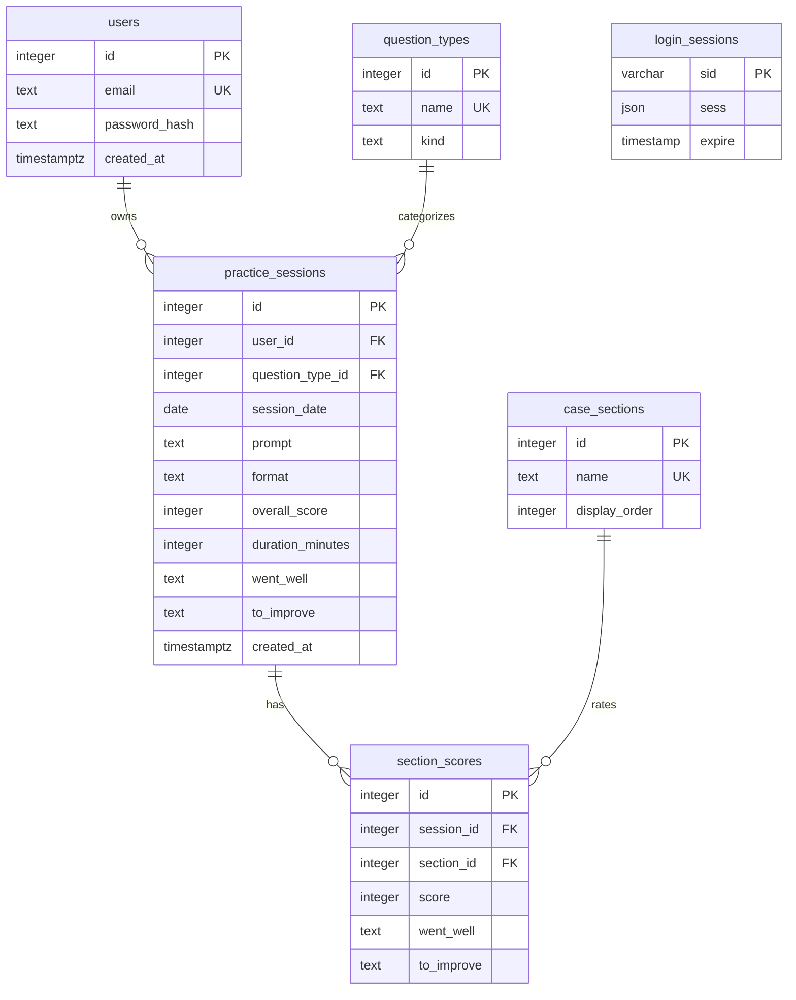

# InterviewPrep database schema — Features 1–4

The application's SQL source of truth is
`artifacts/interviewprep/server/schema.sql`. There are five product tables
(`users`, `question_types`, `practice_sessions`, `case_sections`, and
`section_scores`) plus the existing technical `login_sessions` table used for
authentication. No story or star tables exist, and `practice_sessions` has no
`story_id` column.

## users

| Column | PostgreSQL type | Rules |
| --- | --- | --- |
| id | integer (`SERIAL`) | Primary key, automatically assigned |
| email | text | Required, unique, checked to be lowercase |
| password_hash | text | Required bcrypt password hash, never plaintext |
| created_at | timestamp with time zone | Required, defaults to `now()` |

## question_types

Shared reference data: the same rows are available to every logged-in user.
There is no user ownership column.

| Column | PostgreSQL type | Rules |
| --- | --- | --- |
| id | integer (`SERIAL`) | Primary key, automatically assigned |
| name | text | Required, unique |
| kind | text | Required; database check allows only `case` or `behavioral` |

Initial reference rows:

- **Case:** Market Sizing, Profitability, Market Entry, M&A, Growth Strategy,
  Pricing, Operations.
- **Behavioral:** Leadership, Teamwork, Conflict, Failure / Setback, Impact,
  Why Consulting.

## practice_sessions

Each practice session belongs to exactly one user. Feature 3 uses this existing
table for the authenticated practice log, creation, detail, editing, and deletion.
No new tables or columns are needed.

| Column | PostgreSQL type | Rules |
| --- | --- | --- |
| id | integer (`SERIAL`) | Primary key, automatically assigned |
| user_id | integer | Required foreign key to `users.id`; `ON DELETE CASCADE` |
| question_type_id | integer | Required foreign key to `question_types.id` |
| session_date | date | Required calendar date, no time of day |
| prompt | text | Required |
| format | text | Required, defaults to `solo`; database check allows `solo`, `partner`, or `mock` |
| overall_score | integer | Required; database check allows only 1 through 5 |
| duration_minutes | integer | Optional |
| went_well | text | Optional overall notes |
| to_improve | text | Optional overall notes |
| created_at | timestamp with time zone | Required, defaults to `now()` |

The database enforces required values, valid kinds/formats, score range, integer
types, and foreign keys, regardless of which client submits data. Both foreign
key columns have indexes. Deleting a user deletes their practice sessions;
deleting a question type that is referenced by a session is rejected.

## login_sessions (existing authentication infrastructure)

This is the separately approved session-store table from Feature 1, not an
interview-practice table.

| Column | PostgreSQL type | Rules |
| --- | --- | --- |
| sid | character varying | Primary key, required; login-session identifier |
| sess | json | Required; server-side session data |
| expire | timestamp without time zone, precision 6 | Required; expiry time, indexed |

The authenticated user's numeric ID is stored inside `sess` by express-session.
This is not a relational foreign key to `users`; deleting a user does not
automatically delete these cookie sessions. Authentication middleware checks
that the referenced user still exists before allowing protected API access.

## Relationships in plain English

- A user has many practice sessions. Each practice session belongs to one user.
- A question type has many practice sessions. Each practice session has one
  question type.
- All users share the question-type reference list.
- A login session may refer to a user through its JSON payload; that is an
  application-level relationship, not a database foreign key.



## Migration and automatic seeding

1. **Development:** The existing development-only `scripts/post-merge.sh`
   installs dependencies and applies `server/schema.sql`. The SQL adds missing
   tables/indexes without dropping existing tables or account data.
2. **Production schema:** When the user chooses to publish, Replit's managed
   Publish process applies the development-to-production schema comparison.
   Review that comparison to ensure all six tables exist before serving the
   updated app. No custom production migration or startup DDL is used.
3. **Startup seeding, both environments:** Before opening its listening port,
   `server/index.mjs` calls `seedQuestionTypes()` and `seedCaseSections()`. Parameterized inserts
   adds missing rows with `ON CONFLICT (name) DO NOTHING`. Existing rows and IDs
   are preserved. Repeated or simultaneous startups do not duplicate names.
   This runs against the app's configured database in development and in
   production; production does not depend on copying development table data.
4. Seeding requires the schema to exist first. If provisioning or the database
   is unavailable, startup fails rather than presenting a fake reference list.

No app publishing or production database modification was performed for this
feature. Production-settings tests use only an isolated development schema.

## API and welcome page

`GET /api/question-types` requires the Feature 1 login session and returns:

```json
{
  "case": [{"id": 1, "name": "Growth Strategy", "kind": "case"}],
  "behavioral": [{"id": 8, "name": "Conflict", "kind": "behavioral"}]
}
```

The example is abbreviated and IDs are illustrative, not fixed. All question
types are returned alphabetically within their groups. Unauthenticated requests
return HTTP 401. The welcome page consumes this API to display the Case and
Behavioral chips under “Your practice areas,” with loading, retry, and empty
states rather than hardcoded reference data.

## Checks and manual preview

- Run `pnpm test` for auth regressions, reference seeding, database constraints,
  user-session cascade, protected API access, and production-settings checks.
- Run `pnpm typecheck` for workspace TypeScript checks.
- In Preview, log in and confirm the welcome page lists all seven case types
  and all six behavioral types; refresh and confirm they remain.
- At phone width, chips wrap within the cards without page-wide horizontal
  scrolling. At laptop width the groups appear side by side.
- Log out and request `/api/question-types`; expect HTTP 401.
- Restart the product workflow and confirm no duplicate reference rows appear.

## Practice-session API (Feature 3)

All endpoints require the current login session. POST, PUT, and DELETE also
require its `X-CSRF-Token`. Ownership always comes from the authenticated user,
never a submitted `user_id`. Missing, malformed, and foreign IDs return the
same HTTP 404 response, including for updates and deletion.

| Method | Endpoint | Result |
| --- | --- | --- |
| GET | `/api/sessions` | Current user's sessions, newest practice date first (creation time and ID break ties) |
| POST | `/api/sessions` | Create and return a session with HTTP 201 |
| GET | `/api/sessions/:id` | Return one owned session |
| PUT | `/api/sessions/:id` | Replace editable fields on an owned session |
| DELETE | `/api/sessions/:id` | Delete an owned session with HTTP 204 |

Session responses contain `id`, all editable fields, `question_type_name`,
`kind`, and `created_at`. They do not expose `user_id`. `session_date` is a
`YYYY-MM-DD` calendar-date string, without time-zone conversion.

POST and PUT require `session_date` (a real calendar date, not in the future), `question_type_id`
(an existing shared type), nonblank `prompt`, `format` (`solo`, `partner`, or
`mock`), and integer `overall_score` from 1 to 5. Optional `duration_minutes`
is null or a whole number from 1 to 600. Optional `went_well` and
`to_improve` are overall notes, not section feedback. Text is trimmed and
limited to 4,000 characters per field. Omitted/blank optional notes and omitted
or null minutes become SQL NULL; PUT can explicitly clear existing values.
Numeric JSON fields must be numbers, not numeric strings.

Invalid fields return HTTP 400:

```json
{
  "errors": {"overall_score": "Please give this session an overall score from 1 to 5."}
}
```

The UI performs matching inline checks and displays server field errors.
Both POST and PUT use the shared server validator before writing any data.
Invalid requests leave the parent session and all section scores unchanged.
New and edit forms disable native validation bubbles, retain drafts, show red
field messages and a summary, and scroll/focus the first invalid field on submit.
Each field error clears once that field is corrected, without moving focus.
Nonempty section scores are rejected for behavioral sessions; case section IDs
must exist, cannot repeat, and must have whole-number scores from 1 to 5.
The OpenAPI contract and generated React Query hooks live in `lib/api-spec`
and `lib/api-client-react`. The Express router validates inputs before SQL and
uses parameterized, ownership-scoped queries for every read and mutation.

Protected frontend routes:

- `/sessions` — saved practice log, with loading, retry, and empty states.
- `/sessions/new` — create a practice session.
- `/sessions/:id` — session detail and confirmation-before-delete.
- `/sessions/:id/edit` — edit current values, including clearing optional fields.

`pnpm test` includes real-database session CRUD, invalid input, CSRF, date
round-trip, deletion persistence, and two-user isolation tests. Browser checks
should cover create → reload → edit → reload → cancel deletion → confirm
deletion, and check phone/laptop layouts. No stars, dashboard, or
story features are included.

The root `npm test` script also runs Vitest with Supertest against the exported
Express app (no listening server required). `tests/data-isolation.test.ts`
signs up two uniquely named accounts using separate cookie agents, creates
“Coffee chain profitability” as User A, checks that User B's list is empty and
direct access returns 404 `Session not found`, and confirms User B cannot update
or delete A's record. It also checks that a forged `user_id` cannot change
ownership. Cleanup removes the test login sessions and accounts, relying on
the foreign-key cascade to remove only their practice sessions.

The session form filters its question-type dropdown with a Case/Behavioral
toggle, infers the correct toggle when editing, and clears the selection when
switching kinds. For Feature 3, save failures show only
“Couldn't save. Please check your entries.” Server-side input checks remain in
place for security and data integrity; detailed per-field UI messages are
deferred to Feature 5.

## Case scorecard (Feature 4)

### case_sections — shared reference data

| Column | PostgreSQL type | Rules |
| --- | --- | --- |
| id | integer (`SERIAL`) | Primary key, automatically assigned |
| name | text | Required, unique |
| display_order | integer | Required; determines scorecard order |

Startup inserts only missing names in both development and production, preserving
existing rows and IDs. The seven initial rows are:

1. Introduction
2. Framework
3. Exhibits
4. Math
5. Brainstorm
6. Recommendation
7. Driving the case forward

`GET /api/case-sections` requires login and returns `id`, `name`, and
`display_order`, sorted by `display_order`. These rows are shared by all users.

### section_scores — private through the parent session

| Column | PostgreSQL type | Rules |
| --- | --- | --- |
| id | integer (`SERIAL`) | Primary key, automatically assigned |
| session_id | integer | Required foreign key to `practice_sessions.id`, `ON DELETE CASCADE` |
| section_id | integer | Required foreign key to `case_sections.id` |
| score | integer | Required; database check restricts to 1–5 |
| went_well | text | Optional section-level notes |
| to_improve | text | Optional section-level notes |

**A practice session has many section scores, at most one per case section.**
The database enforces a unique `(session_id, section_id)` pair. A case section
may be referenced by many practice sessions. **N/A means no row**, not a null
score or a score of zero. Deleting a practice session automatically deletes its
scores. Deleting a user cascades through their sessions to their scores.

There are no independent section-score CRUD endpoints. Every private read or
write goes through an owned parent session. Foreign and nonexistent sessions
both return 404 `Session not found`.

### Atomic create and edit

POST and PUT accept an optional `section_scores` array:

```json
{
  "section_scores": [
    {"section_id": 1, "score": 4, "went_well": "Clear opening", "to_improve": null}
  ]
}
```

The ID is illustrative. The rest of the normal session fields are still
required. The client sends only scored sections; N/A sections are omitted.

The server opens one transaction, validates input and reference IDs, writes the
parent, deletes that session's old section scores, and inserts its currently
scored sections. It commits only after all steps succeed. A failure restores
the original parent and all old scores; partial cards are never committed.
Editing locks the owned parent row first, so concurrent edits cannot interleave
their replacements. The unique constraint provides a second defense against
duplicate sections.

An empty or omitted array replaces the card with all N/A. Changing the question
type to Behavioral always clears its section scores, even if the request still
contains old scored sections.

GET `/api/sessions/:id`, POST, and PUT return `section_scores`, sorted by section
`display_order`. Each scored row includes `id`, `section_id`, `score`, notes,
`section_name`, and `display_order`. The detail read uses one ownership-scoped
SQL statement for a consistent snapshot. The list remains a lightweight summary.

The form shows the seven-row scorecard only for Case sessions. Notes expand on
request and start expanded when editing a section with saved notes. Detail
shows a desktop table or phone cards, including gray N/A sections. Scores and
notes use the same Save action as the session, not separate requests.

`npm test` covers ordered/idempotent production-settings seeding, direct DB
constraints, parent ownership, invalid scorecards, real rollback after a failed
child insertion, repeated and concurrent replacement, N/A removal,
Case-to-Behavioral cleanup, and parent-deletion cascade. The original root
Vitest data-isolation test continues to run unchanged.
